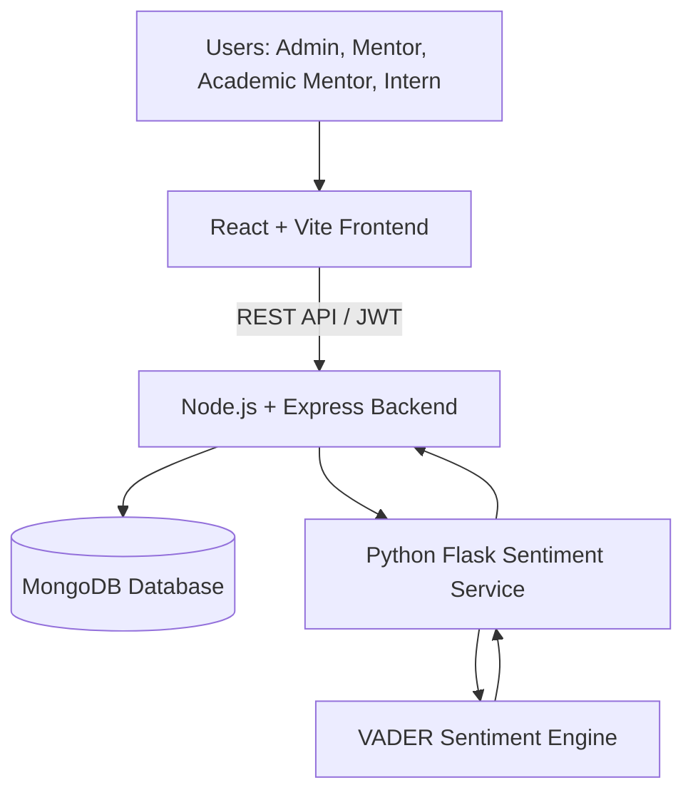
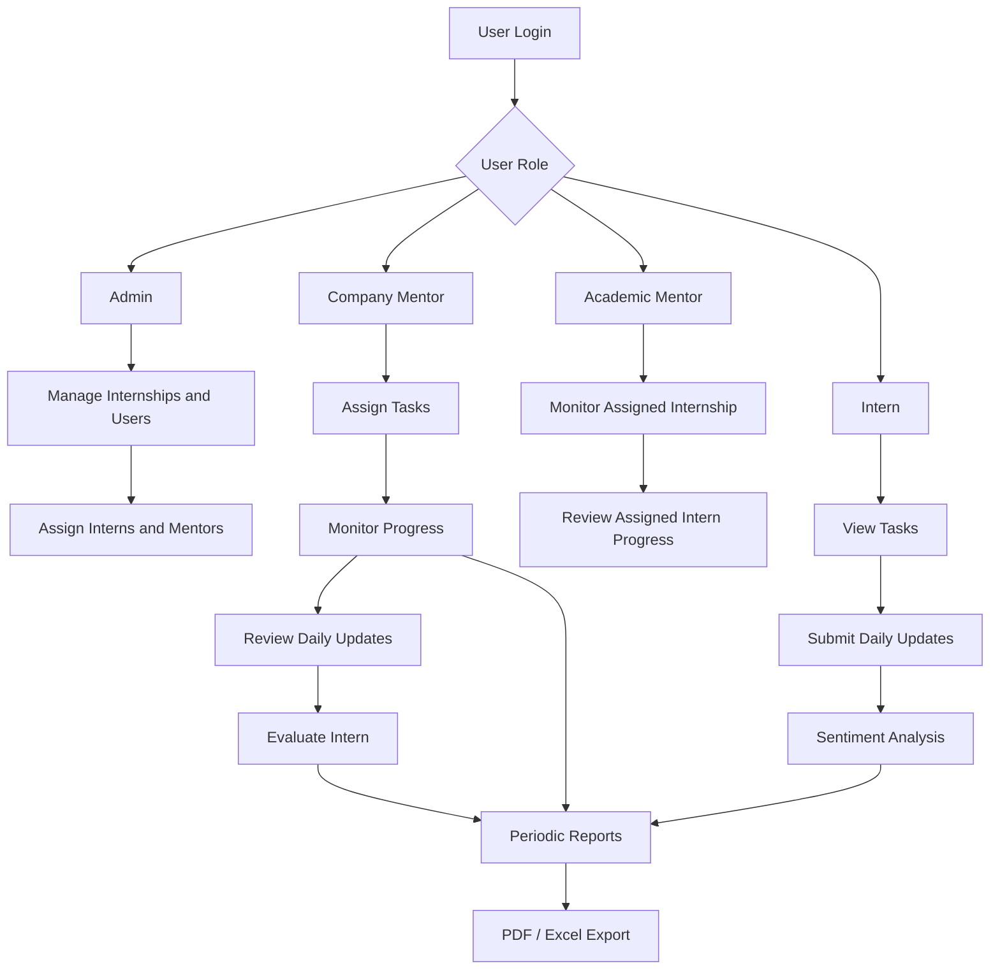

# InternTracker
### AI-Based Internship Management & Performance Evaluation System

> A centralized platform for managing internships, monitoring intern progress, evaluating performance, and analyzing daily updates.

---

## 📌 Project Overview

**InternTracker** is a web-based internship management system designed to simplify and improve the process of managing interns within organizations and academic institutions.

The platform provides a centralized system where administrators can manage internships, Company Mentors can assign tasks and evaluate interns, interns can submit daily progress updates, and Academic Mentors can monitor assigned internships.

The system integrates sentiment analysis to analyze the emotional tone of interns' daily updates and provides periodic reports to support performance monitoring and evaluation.

---

## 🎯 Problem Statement

Traditional internship management often relies on spreadsheets, emails, messaging applications, and manual reporting. These methods make it difficult to track intern activities, monitor task progress, maintain records, and evaluate performance efficiently.

InternTracker addresses these problems by providing a centralized, role-based platform for internship management, progress tracking, mentor supervision, and reporting.

---

## 🎯 Objectives

- Centralize internship information and intern records.
- Simplify internship assignment and management.
- Track tasks, deadlines, and completion progress.
- Allow interns to submit daily work updates.
- Enable Company Mentors to monitor and evaluate interns.
- Enable Academic Mentors to supervise assigned interns.
- Analyze daily updates using sentiment analysis.
- Generate weekly and monthly internship reports.
- Maintain secure access using authentication and role-based authorization.

---

## ✨ Key Features

### 1. User Authentication and Authorization
- Secure user registration and login.
- JWT-based authentication.
- Role-based access control.
- Protected routes and APIs.

### 2. Internship Management
- Create and manage internship records.
- Assign interns to internships.
- Assign Company Mentors.
- Assign Academic Mentors.
- Track internship details and status.

### 3. Task Management
- Assign tasks to interns.
- Maintain task details and deadlines.
- Track task progress.
- Monitor task completion status.

### 4. Daily Progress Updates
- Interns submit daily work updates.
- Record work completed and progress details.
- Maintain daily activity history.
- Allow authorized mentors to review updates.

### 5. Sentiment Analysis
- Analyze the sentiment of interns' daily updates.
- Use Python Flask and VADER sentiment analysis.
- Identify positive, negative, or neutral sentiment.
- Provide additional insight into intern feedback and experiences.

> Sentiment analysis is intended as an indicator of the emotional tone of written updates, not a replacement for professional performance evaluation.

### 6. Mentor Evaluation
- Company Mentors evaluate interns.
- Record evaluation scores and feedback.
- Review intern performance.
- Maintain evaluation history.

### 7. Academic Mentor Supervision
- Assign Academic Mentors to specific internships.
- Allow Academic Mentors to monitor their assigned interns.
- View internship-related progress and records.
- Enforce internship-level access restrictions.

### 8. Periodic Reports
- Generate weekly internship reports.
- Generate monthly internship reports.
- Summarize tasks and progress.
- Include attributable daily updates, evaluations, and sentiment summaries.
- Export reports in PDF and Excel formats.

### 9. Role-Based Dashboards
Provide different dashboards based on the user's role, displaying relevant data, activities, and management options.

---

## 👥 User Roles

| Role | Responsibilities |
|---|---|
| SUPERADMIN | Manage the overall platform and create/manage users, including Academic Mentors. |
| ADMIN | Manage company-level users and internships, assign interns, mentors, and Academic Mentors. |
| MENTOR | Assign tasks, monitor progress, review daily updates, and evaluate interns. |
| ACADEMIC_MENTOR | Supervise specifically assigned internships and monitor assigned interns. |
| INTERN | View internship details, manage assigned tasks, and submit daily updates. |

### Access Control

- Interns can access their own internship information and activities.
- Company Mentors can access interns and internships assigned to them according to authorization rules.
- Academic Mentors can access only their explicitly assigned internship scope.
- Company Admins are restricted to their authorized company data.
- Protected backend APIs enforce authorization in addition to frontend route protection.

---

## 🛠️ Technology Stack

### Frontend

| Technology | Purpose |
|---|---|
| React.js | Frontend user interface |
| Vite | Development server and build tool |
| JavaScript | Application programming |
| Axios | API communication |
| React Router | Client-side routing |
| CSS | UI styling |

### Backend

| Technology | Purpose |
|---|---|
| Node.js | Backend runtime |
| Express.js | REST API framework |
| JavaScript (CommonJS) | Backend development |
| JWT | Authentication |
| bcrypt | Password hashing |
| Mongoose | MongoDB object modeling |

### Database

| Technology | Purpose |
|---|---|
| MongoDB | Persistent application database |
| Mongoose | Schema design and database operations |

### Sentiment Analysis

| Technology | Purpose |
|---|---|
| Python | Sentiment service programming |
| Flask | Sentiment analysis API |
| VADER | Sentiment analysis library |

### Development Tools

- Visual Studio Code
- Git
- GitHub
- Postman
- MongoDB Compass

---

## 🏗️ System Architecture

InternTracker follows a frontend-backend architecture with a separate sentiment analysis service.



### Architecture Description

1. Users interact with the application through the React frontend.
2. The frontend communicates with the backend through REST APIs.
3. JWT is used to authenticate API requests.
4. Express backend services handle business logic and authorization.
5. MongoDB stores application data.
6. The sentiment service processes daily updates using VADER.
7. Results are used in relevant dashboards and reports.

---

## 📂 Project Structure

> The following is an illustrative structure. Update it to match the exact current folders and filenames in your repository.

```text
InternTracker/
│
├── Frontend/
│   ├── src/
│   │   ├── components/
│   │   ├── pages/
│   │   ├── services/
│   │   ├── routes/
│   │   └── ...
│   ├── public/
│   └── package.json
│
├── Backend/
│   ├── modules/
│   │   ├── auth/
│   │   ├── user/
│   │   ├── internship/
│   │   ├── task/
│   │   ├── dailyUpdate/
│   │   ├── evaluation/
│   │   └── report/
│   ├── middleware/
│   ├── config/
│   ├── tests/
│   └── package.json
│
├── SentimentService/
│   ├── app.py
│   ├── requirements.txt
│   └── ...
│
├── docs/
│   ├── PROJECT_OVERVIEW.md
│   ├── SYSTEM_ARCHITECTURE.md
│   ├── DATABASE_DESIGN.md
│   ├── API_DOCUMENTATION.md
│   ├── INSTALLATION.md
│   └── TESTING.md
│
├── .gitignore
└── README.md
```

---

## 🔄 Application Workflow



---

## 📊 Reporting

InternTracker supports periodic internship reporting.

### Weekly Reports
Summarize internship activities and progress for a selected week.

### Monthly Reports
Summarize internship activities and progress for a selected calendar month.

### Report Contents

- Internship information
- Reporting period
- Report generation date
- Task details and progress
- Attributable daily updates
- Mentor evaluations
- Sentiment summary

### Export Formats

- PDF
- Excel (.xlsx)

---

## 🔐 Security

- JWT authentication.
- Password hashing using bcrypt.
- Role-based access control.
- Protected API endpoints.
- Company-level data isolation.
- Internship-level authorization for Academic Mentors.
- Backend authorization checks.
- Restricted access to personal internship records.
- Input validation and error handling.

---

## 🚀 Installation and Setup

### Prerequisites

Install the following:

- Node.js and npm
- MongoDB Community Server or MongoDB Atlas
- Python 3
- Git
- Visual Studio Code

### 1. Clone the Repository

```bash
git clone YOUR_GITHUB_REPOSITORY_URL
cd InternTracker
```

Replace `YOUR_GITHUB_REPOSITORY_URL` with your actual GitHub repository URL.

### 2. Install Frontend Dependencies

```bash
cd Frontend
npm install
```

### 3. Install Backend Dependencies

Open another terminal:

```bash
cd Backend
npm install
```

### 4. Configure Environment Variables

Create the required `.env` files according to the backend and frontend configurations.

Do not commit secret keys, database credentials, or production environment files.

Refer to `.env.example` files where available.

### 5. Start MongoDB

Ensure your MongoDB server is running, or configure the connection to MongoDB Atlas.

### 6. Start Backend

From the Backend directory, run the development command defined in its `package.json`.

For example:

```bash
npm run dev
```

### 7. Start Frontend

From the Frontend directory:

```bash
npm run dev
```

### 8. Start Sentiment Service

Navigate to the sentiment service directory, install its Python requirements, configure its environment, and start the Flask application using the actual run command defined in the service.

> Exact ports, environment variables, and commands should be confirmed from the current project configuration.

---

## 🧪 Testing

Testing includes verification of the following areas:

- Authentication and login
- Role-based access control
- Internship creation and assignment
- Task creation and task progress
- Daily progress updates
- Sentiment analysis
- Mentor evaluation
- Academic Mentor authorization
- Weekly and monthly report generation
- PDF and Excel exports
- API validation and error handling

Backend automated tests and frontend production builds are used to verify application functionality.

---

## 🔮 Future Scope

Potential future enhancements include:

- In-app notification system
- Email notifications and reminders
- Automatic task deadline reminders
- Improved performance analytics
- Advanced dashboard charts
- Additional evaluation criteria
- Academic Mentor feedback and evaluation workflow
- Mobile-friendly improvements
- AI-assisted progress insights
- Deployment to a cloud platform

> Future scope items are proposed improvements and should not be considered implemented unless verified.

---

## 🎓 Project Information

**Project Name:** InternTracker

**Project Type:** Web-Based Internship Management System

**Project Domain:** Web Development / Artificial Intelligence

**Primary Technologies:** React, Node.js, Express, MongoDB, Python, Flask, VADER

**Purpose:** To simplify internship management, monitor intern progress, support mentor evaluations, and generate internship reports.

---

## 👨‍💻 Contributors

Add the names of your project team members here.

---

## 📄 License

Specify the license applicable to your project repository.

---

*InternTracker — Manage Internships. Monitor Progress. Evaluate Performance.*
