# InternTracker
## AI-Based Internship Management & Performance Evaluation System

**Manage Internships. Monitor Progress. Evaluate Performance.**

InternTracker is a web-based internship management platform designed to simplify internship administration, task tracking, mentor supervision, performance evaluation, sentiment analysis, and periodic report generation.

---

# Table of Contents

1. [Introduction](#1-introduction)
2. [Problem Statement](#2-problem-statement)
3. [Objectives](#3-objectives)
4. [Scope](#4-scope)
5. [User Roles](#5-user-roles)
6. [Features](#6-features)
7. [Technology Stack](#7-technology-stack)
8. [System Architecture Diagram](#8-system-architecture-diagram)
9. [Use Case Diagram](#9-use-case-diagram)
10. [DFD Level 0](#10-data-flow-diagram-level-0)
11. [DFD Level 1](#11-data-flow-diagram-level-1)
12. [ER Diagram](#12-entity-relationship-diagram)
13. [Class Diagram](#13-class-diagram)
14. [Sequence Diagrams](#14-sequence-diagrams)
15. [Activity Diagram](#15-activity-diagram)
16. [Deployment Diagram](#16-deployment-diagram)
17. [Component Diagram](#17-component-diagram)
18. [Project Structure](#18-project-structure)
19. [Security](#19-security)
20. [Reports](#20-reports)
21. [Installation and Setup](#21-installation-and-setup)
22. [Testing](#22-testing)
23. [Future Scope](#23-future-scope)

---

# 1. Introduction

InternTracker is developed to provide a centralized platform for managing internship activities and evaluating intern performance.

The system connects company administrators, Company Mentors, Academic Mentors, and interns through role-based dashboards.

Interns can view assigned tasks and submit daily progress updates. Company Mentors can monitor work, assign tasks, and evaluate interns. Academic Mentors can supervise internships specifically assigned to them.

The platform also integrates sentiment analysis using Python Flask and VADER to analyze the emotional tone of daily updates.

Weekly and monthly reports can be generated and exported into PDF and Excel formats.

# 2. Problem Statement

Traditional internship management often depends on spreadsheets, emails, and manual communication.

This creates difficulties such as:

- Difficulty tracking daily intern activities.
- Lack of centralized internship records.
- Manual task assignment and monitoring.
- Difficulty evaluating intern performance.
- Limited communication between company and academic mentors.
- Time-consuming report preparation.
- Difficulty analyzing intern feedback and progress.

InternTracker aims to solve these problems through an integrated web-based system.

# 3. Objectives

- Develop a centralized internship management platform.
- Provide secure login and role-based access.
- Manage internship assignments and records.
- Enable task assignment and progress tracking.
- Allow interns to submit daily work updates.
- Analyze update sentiment using VADER.
- Enable Company Mentor evaluations.
- Provide Academic Mentor supervision.
- Generate weekly and monthly reports.
- Export reports into PDF and Excel formats.

# 4. Scope

The project covers:

1. User authentication and authorization.
2. Company and internship management.
3. Intern and mentor assignments.
4. Task management.
5. Daily progress tracking.
6. Sentiment analysis.
7. Mentor performance evaluations.
8. Academic Mentor supervision.
9. Periodic report generation.
10. PDF and Excel exports.

# 5. User Roles

| Role | Description |
|---|---|
| SUPERADMIN | Manages platform-level users and administrative operations. |
| ADMIN | Manages company-level internships, interns, and mentor assignments. |
| MENTOR | Assigns tasks, monitors interns, and evaluates performance. |
| ACADEMIC_MENTOR | Supervises explicitly assigned internships and interns. |
| INTERN | Views assigned tasks and submits daily progress updates. |

# 6. Features

## 6.1 Authentication

- JWT-based authentication.
- Password hashing using bcrypt.
- Role-based authorization.
- Protected frontend routes and backend APIs.

## 6.2 Internship Management

- Create and manage internship records.
- Assign interns.
- Assign Company Mentors.
- Assign Academic Mentors.
- Monitor internship information.

## 6.3 Task Management

- Create and assign tasks.
- Set task deadlines.
- Track task progress.
- Monitor completion status.

## 6.4 Daily Updates

- Submit daily work updates.
- Maintain progress history.
- Allow authorized mentors to review updates.

## 6.5 Sentiment Analysis

- Python Flask-based sentiment service.
- VADER sentiment analysis.
- Positive, negative, and neutral classifications.
- Sentiment summaries in relevant reports.

Sentiment is an additional indicator and should not be treated as a direct replacement for performance evaluation.

## 6.6 Performance Evaluation

- Company Mentor evaluation.
- Evaluation scores and feedback.
- Performance history.

## 6.7 Academic Mentor Supervision

- Assign Academic Mentors to internships.
- View explicitly assigned interns.
- Monitor authorized internship progress.
- Enforce internship-level data restrictions.

## 6.8 Periodic Reports

- Weekly reports.
- Monthly reports.
- Task progress summaries.
- Daily update summaries.
- Mentor evaluations.
- Sentiment summaries.
- PDF and Excel exports.

# 7. Technology Stack

| Layer | Technologies |
|---|---|
| Frontend | React.js, Vite, JavaScript |
| Backend | Node.js, Express.js |
| Database | MongoDB |
| ODM | Mongoose |
| Authentication | JWT |
| Password Security | bcrypt |
| Sentiment Service | Python, Flask |
| Sentiment Library | VADER |
| API Communication | Axios, REST API |
| Development | VS Code, Git, GitHub, Postman |

---

# 8. System Architecture Diagram

This diagram shows how the frontend, backend, database, and sentiment service communicate.

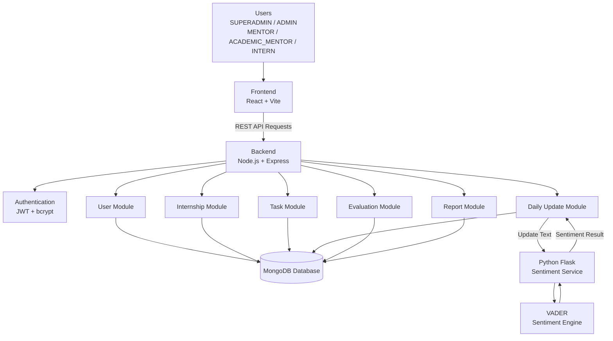

### Architecture Explanation

1. Users access the application through React.
2. React communicates with Express using REST APIs.
3. JWT authentication verifies the user.
4. Backend modules handle application operations.
5. MongoDB stores persistent application data.
6. Daily update text is processed by the Flask sentiment service.
7. VADER returns sentiment results.
8. The reporting module prepares periodic reports.

---

# 9. Use Case Diagram

This diagram represents the interactions between the five user roles and the system.

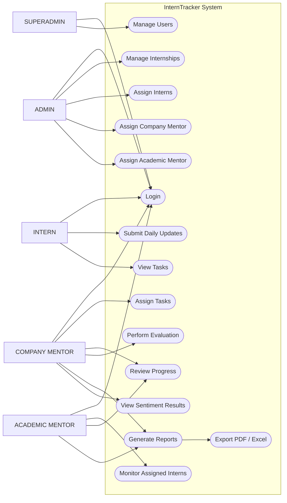

### Use Case Explanation

- SUPERADMIN manages platform users.
- ADMIN manages company-level internships and assignments.
- Company Mentors manage tasks, monitor progress, and evaluate interns.
- Academic Mentors supervise assigned internship records.
- Interns view their tasks and submit daily updates.
- Authorized users generate and export reports according to their permissions.

---

# 10. Data Flow Diagram Level 0

DFD Level 0 represents the complete system as one process.

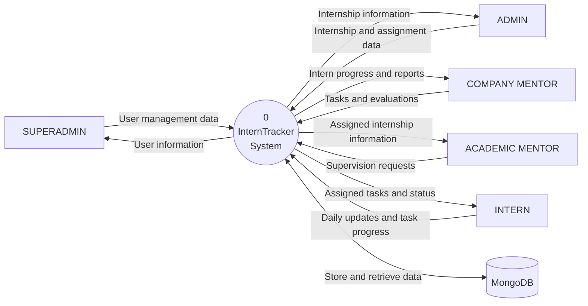

### DFD Level 0 Explanation

The InternTracker system receives information from different users, processes their requests, and stores or retrieves information from MongoDB.

Each user receives information based on their role and authorization.

---

# 11. Data Flow Diagram Level 1

DFD Level 1 breaks the main system into smaller processes.

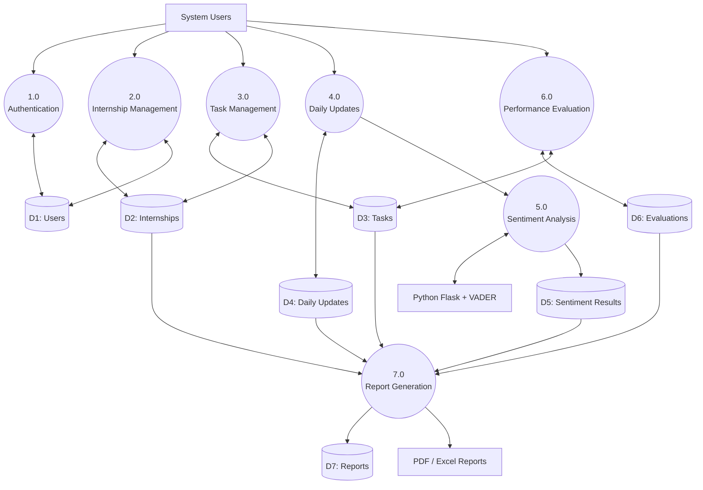

### DFD Level 1 Explanation

The system contains seven major processes:

1. Authentication verifies users.
2. Internship Management handles internship records and assignments.
3. Task Management handles task creation and progress.
4. Daily Updates stores intern work updates.
5. Sentiment Analysis processes update text.
6. Performance Evaluation stores mentor assessments.
7. Report Generation creates weekly and monthly reports.

The actual report contents depend on available and authorized records.

---

# 12. Entity Relationship Diagram

The following is a conceptual ER diagram. Confirm the exact fields, collection names, and relationships against the current Mongoose schemas before treating it as the final database specification.

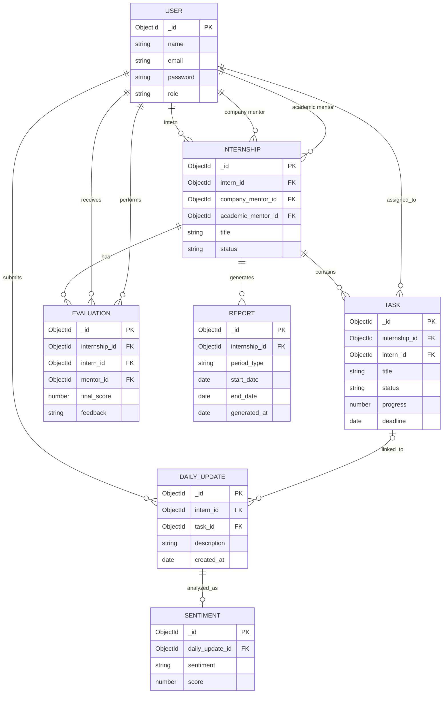

### ER Diagram Explanation

- A user can participate in different internship-related roles.
- An internship can have an intern, Company Mentor, and Academic Mentor association.
- An internship can contain multiple tasks.
- Interns submit daily updates.
- Daily updates may be associated with tasks.
- Daily updates can have sentiment analysis results.
- Evaluations are associated with internship and user records.
- Reports are generated for internship reporting periods.

**Important:** The diagram describes conceptual relationships, not a guarantee that every reference is physically stored in exactly this way. Check your schemas before final submission.

---

# 13. Class Diagram

This diagram represents the main conceptual classes and their responsibilities.

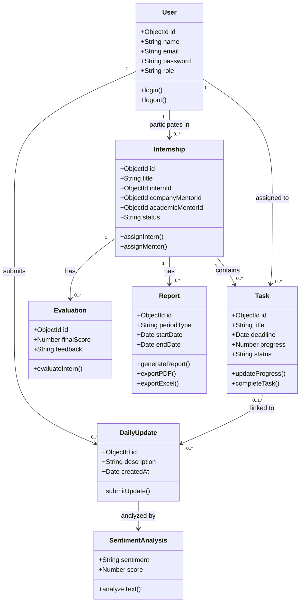

### Class Diagram Explanation

The diagram illustrates the major objects and their relationships.

- User represents all application roles.
- Internship represents an internship record.
- Task represents assigned work.
- DailyUpdate represents submitted progress.
- SentimentAnalysis processes daily update text.
- Evaluation represents mentor assessment.
- Report represents generated periodic reports.

---

# 14. Sequence Diagrams

## 14.1 Login Sequence Diagram

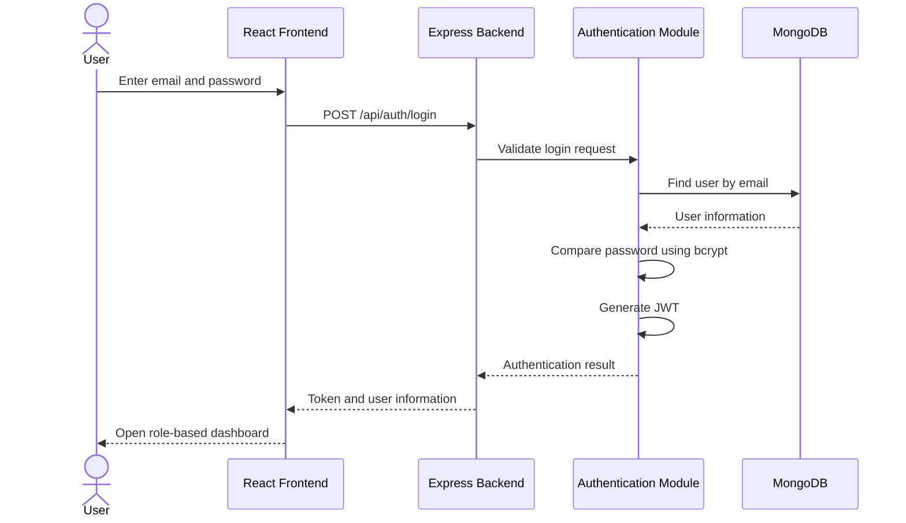

## 14.2 Task Assignment Sequence Diagram

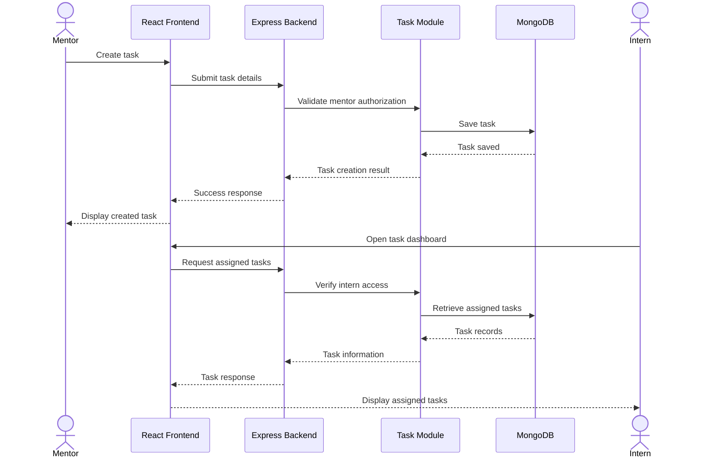

## 14.3 Daily Update and Sentiment Analysis Sequence

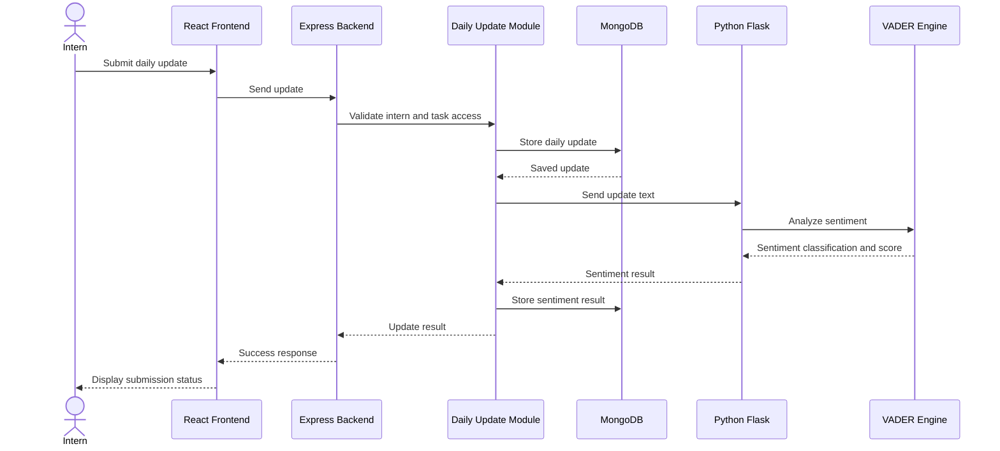

## 14.4 Report Generation Sequence

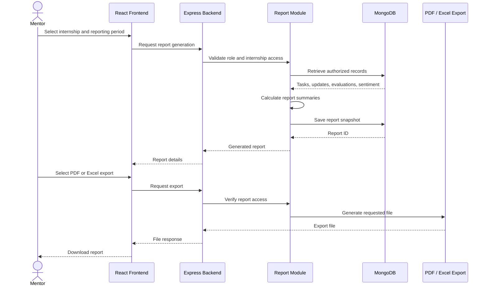

---

# 15. Activity Diagram

This activity diagram describes the general internship workflow.

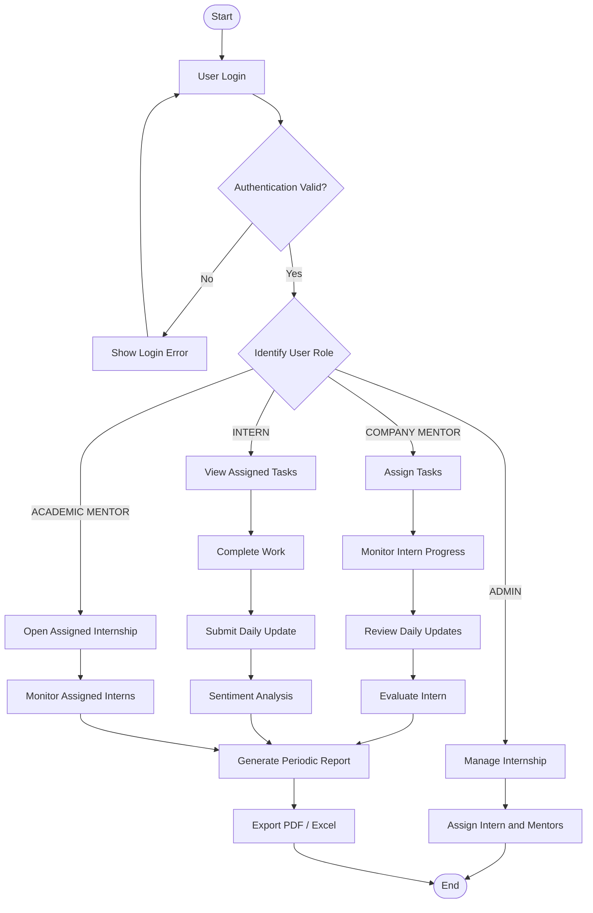

### Activity Diagram Explanation

The workflow begins with user authentication.

After successful login, the system displays functionality based on the user's role.

Interns submit updates, mentors monitor and evaluate progress, Academic Mentors supervise assigned internships, and authorized users generate reports.

---

# 16. Deployment Diagram

The deployment diagram shows the expected application execution environment.

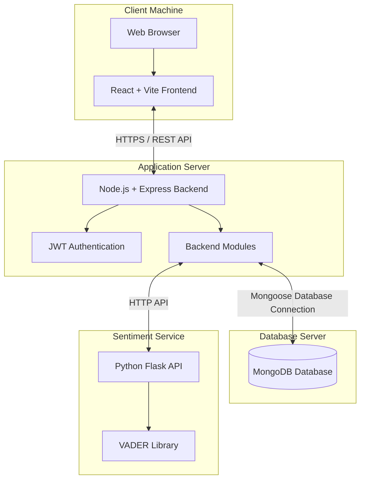

### Deployment Explanation

- Client machine runs the web browser and React application.
- Application server runs Node.js and Express.
- MongoDB stores persistent records.
- Python Flask runs the sentiment analysis service.
- Backend communicates with MongoDB and Flask.

The exact deployment environment may be a local development machine or a configured cloud/server environment.

---

# 17. Component Diagram

The component diagram represents the major software modules and their communication.

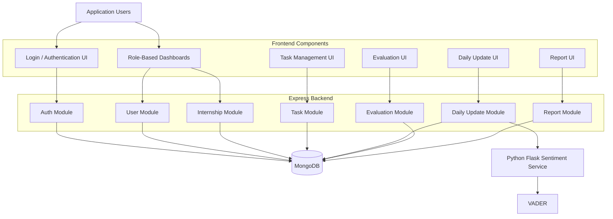

### Component Explanation

The frontend provides user interfaces for different roles.

The backend contains modules for authentication, users, internships, tasks, daily updates, evaluations, and reports.

MongoDB provides persistent storage. The separate Flask service performs sentiment analysis through VADER.

---

# 18. Project Structure

The following is a representative structure. Verify the exact folder names and files in the current repository.

```text
InternTracker/
│
├── Frontend/
│   ├── src/
│   │   ├── components/
│   │   ├── pages/
│   │   │   ├── admin/
│   │   │   ├── mentor/
│   │   │   ├── intern/
│   │   │   └── academicMentor/
│   │   ├── services/
│   │   ├── routes/
│   │   └── ...
│   ├── public/
│   └── package.json
│
├── Backend/
│   ├── modules/
│   │   ├── auth/
│   │   ├── user/
│   │   ├── internship/
│   │   ├── task/
│   │   ├── dailyUpdate/
│   │   ├── evaluation/
│   │   └── report/
│   ├── middleware/
│   ├── config/
│   ├── tests/
│   └── package.json
│
├── SentimentService/
│   ├── app.py
│   ├── requirements.txt
│   └── ...
│
├── docs/
│
├── .gitignore
└── README.md
```

# 19. Security

The system uses security mechanisms to protect application information.

- JWT authentication.
- bcrypt password hashing.
- Role-based authorization.
- Protected API endpoints.
- Backend-side permission validation.
- Company-level access restrictions.
- Internship-level Academic Mentor restrictions.
- Validation of incoming requests.
- Restricted access to user-specific records.

# 20. Reports

InternTracker supports periodic reporting.

### Weekly Reports

Reports generated for a selected weekly period.

### Monthly Reports

Reports generated for a selected calendar month.

### Report Information

- Internship details.
- Reporting period.
- Generation date.
- Task details and progress.
- Attributable daily updates.
- Company Mentor evaluations.
- Sentiment summary.

### Export Formats

- PDF
- Excel (.xlsx)

Reports use saved snapshots so the displayed report and its exported versions refer to the same generated data.

# 21. Installation and Setup

## Prerequisites

Install:

- Node.js
- npm
- MongoDB Community Server or MongoDB Atlas
- Python 3
- Git
- Visual Studio Code

## Clone Repository

```bash
git clone YOUR_GITHUB_REPOSITORY_URL
cd InternTracker
```

## Install Frontend

```bash
cd Frontend
npm install
npm run dev
```

## Install Backend

Open another terminal:

```bash
cd Backend
npm install
npm run dev
```

## Configure MongoDB

Ensure MongoDB is running and configure the database connection using the project's environment variables.

## Install Sentiment Service

Navigate to the actual sentiment service directory.

```bash
pip install -r requirements.txt
```

Start the Flask service using its configured run command.

## Environment Variables

Create environment files based on the actual project configuration.

Typical settings may include:

```env
PORT=5000
MONGODB_URI=your_mongodb_connection_string
JWT_SECRET=your_secret_key
```

These are illustrative names. Use the exact environment variable names expected by your source code.

Never commit real credentials or secret keys.

# 22. Testing

The following areas should be tested:

| Module | Testing Focus |
|---|---|
| Authentication | Registration, login, JWT validation |
| Users | User creation and role permissions |
| Internship | Creation and mentor assignments |
| Tasks | Assignment, progress, completion |
| Daily Updates | Submission and data access |
| Sentiment | Sentiment classification |
| Evaluation | Scores and feedback |
| Academic Mentor | Assigned-intern restrictions |
| Reports | Weekly/monthly generation |
| Export | PDF and Excel generation |

Run the backend tests using the test command configured in `Backend/package.json`.

Build the frontend using the build command configured in `Frontend/package.json`.

Record actual test results before final submission.

# 23. Future Scope

Potential improvements include:

- In-app notifications.
- Email alerts and deadline reminders.
- Automated overdue task reminders.
- Academic Mentor feedback and evaluation workflow.
- More advanced performance analytics.
- Additional dashboard visualizations.
- Cloud deployment.
- Mobile application.
- AI-assisted progress insights.

These are proposed improvements and are not necessarily implemented features.

---

# Conclusion

InternTracker provides a centralized solution for managing internships and monitoring intern performance.

It integrates internship management, task tracking, daily updates, sentiment analysis, mentor evaluation, Academic Mentor supervision, and periodic report generation.

The platform aims to improve transparency, simplify internship administration, and support data-driven performance monitoring.

---

**Project:** InternTracker

**Domain:** Web Development and Artificial Intelligence

**Primary Technologies:** React, Node.js, Express, MongoDB, Python, Flask, VADER

**Tagline:** Manage Internships. Monitor Progress. Evaluate Performance.
