# InternTracker — Internship Management and Performance Evaluation System

A role-based internship management system built with **React, Vite, Node.js, Express, MongoDB, and Python-based sentiment analysis**. It helps organizations manage internships, daily work updates, mentor evaluations, and monthly performance reports.

## Table of Contents

- [Project Overview](#project-overview)
- [Objectives](#objectives)
- [Key Features](#key-features)
- [User Roles](#user-roles)
- [Technology Stack](#technology-stack)
- [System Architecture](#system-architecture)
- [Backend Modules](#backend-modules)
- [Database Architecture](#database-architecture)
- [Project Structure](#project-structure)
- [System Workflow](#system-workflow)
- [UML and System Diagrams](#uml-and-system-diagrams)
- [Authentication and Authorization](#authentication-and-authorization)
- [Sentiment Analysis](#sentiment-analysis)
- [Performance Evaluation](#performance-evaluation)
- [Monthly Reports](#monthly-reports)
- [API Endpoints](#api-endpoints)
- [Installation](#installation)
- [Running the Project](#running-the-project)
- [Environment Variables](#environment-variables)
- [Testing](#testing)
- [Security](#security)
- [Future Enhancements](#future-enhancements)

## Project Overview

InternTracker is designed to manage the internship lifecycle in one centralized platform. It provides separate access for platform administrators, company administrators, mentors, and interns.

The system supports internship management, internship requests and approvals, daily work updates, sentiment analysis, mentor evaluations, and monthly performance reporting.

The main application uses a Node.js and Express REST API connected to MongoDB. A separate Python Flask service processes text for sentiment analysis.

## Objectives

- Centralize internship and intern records.
- Provide secure login and role-based access.
- Manage companies, internships, mentors, and interns.
- Allow interns to submit daily work updates.
- Analyze the sentiment of submitted updates.
- Enable mentors to review intern progress and record evaluations.
- Generate monthly internship performance summaries.
- Maintain appropriate company and mentor access boundaries.

## Key Features

- JWT-based authentication.
- Role-based dashboards and protected routes.
- Company and user management.
- Internship creation, requests, approval, and assignment.
- Task tracking and independent daily work updates.
- Mentor dashboard and assigned intern profiles.
- Daily work history and sentiment results.
- Mentor performance evaluations.
- Monthly performance reports.
- MongoDB data storage.
- Separate Python sentiment-analysis service.
- Responsive React frontend.

Optional integrations such as Cloudinary file storage and SMTP email notifications should be documented as enabled only when configured in the project.

## User Roles

| Role | Responsibilities |
|---|---|
| `SUPERADMIN` | Platform-level administration and authorized cross-company operations. |
| `ADMIN` | Manages company users, internships, mentor assignments, and reports within the authorized company scope. |
| `MENTOR` | Reviews assigned interns, daily work updates, progress, sentiment results, and evaluations. |
| `INTERN` | Views internship information, submits daily work updates, and views personal performance information. |

## Technology Stack

| Layer | Technology |
|---|---|
| Frontend | React, Vite, JavaScript, CSS |
| Routing | React Router |
| API communication | Axios, REST API, JSON |
| Backend | Node.js, Express.js |
| Database | MongoDB / MongoDB Atlas |
| ODM | Mongoose |
| Authentication | JSON Web Tokens (JWT) |
| Password security | bcrypt / bcryptjs, as configured |
| Validation | express-validator, where configured |
| Sentiment analysis | Python, Flask, VADER-based analysis where configured |
| Version control | Git and GitHub |

## System Architecture

The application consists of a React frontend, an Express backend, a MongoDB database, and a separate sentiment-analysis service.

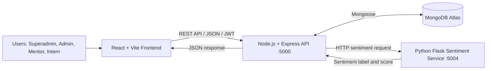

## Backend Modules

The backend is organized around application features and API route families.

| Module | Route prefix | Purpose |
|---|---|---|
| Authentication | `/api/auth` | Registration, login, and current-user information |
| Companies | `/api/companies` | Company management |
| Users | `/api/users` | Role-scoped user management |
| Internships | `/api/internships` | Internship lifecycle and requests |
| Mentor | `/api/mentor` | Mentor dashboard and assigned intern information |
| Tasks | `/api/tasks` | Task management |
| Daily updates | `/api/daily-updates` | Daily work submissions and history |
| Sentiment | `/api/sentiment` | Sentiment analysis and results |
| Evaluations | `/api/evaluations` | Mentor evaluations |
| Reports | `/api/reports` | Performance reports |

Verify the exact routes against the current backend source before treating this table as a definitive API specification.

## Database Architecture

MongoDB is the main application database. Mongoose models may include:

- `User`
- `Company`
- `Internship`
- `Task`
- `DailyUpdate`
- `Sentiment`
- `Evaluation`
- `Report`

Related documents use application-level references such as user IDs, company IDs, internship IDs, and daily-update IDs. These are MongoDB document relationships rather than SQL foreign keys.

Daily work updates can be submitted independently of a task when allowed by the current application rules.

## Project Structure

The following is an illustrative structure. Adjust it to match the actual folders in your repository.

```text
InternTracker/
├── Backend/
│   ├── config/
│   ├── middleware/
│   ├── modules/
│   │   ├── auth/
│   │   ├── company/
│   │   ├── internship/
│   │   ├── mentor/
│   │   ├── task/
│   │   ├── dailyUpdate/
│   │   ├── sentiment/
│   │   ├── evaluation/
│   │   └── report/
│   ├── services/
│   ├── tests/
│   ├── server.js
│   └── package.json
├── Frontend/
│   ├── src/
│   │   ├── components/
│   │   ├── context/
│   │   ├── pages/
│   │   ├── services/
│   │   └── routes.jsx
│   └── package.json
├── docs/
└── README.md
```

## System Workflow

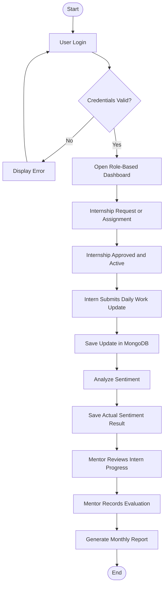

# UML and System Diagrams

GitHub supports Mermaid diagrams in Markdown code blocks. The diagrams below can be previewed directly in the repository README.

## 1. Use Case Diagram

This diagram summarizes the major interactions between user roles and the application.

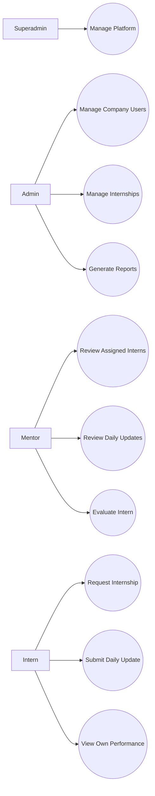

## 2. Data Flow Diagram — Level 0

This diagram presents InternTracker as a single system and shows its interactions with users, the database, and the sentiment service.

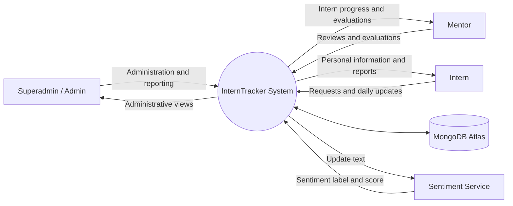

## 3. Data Flow Diagram — Level 1

This diagram breaks the system into its major processing modules.

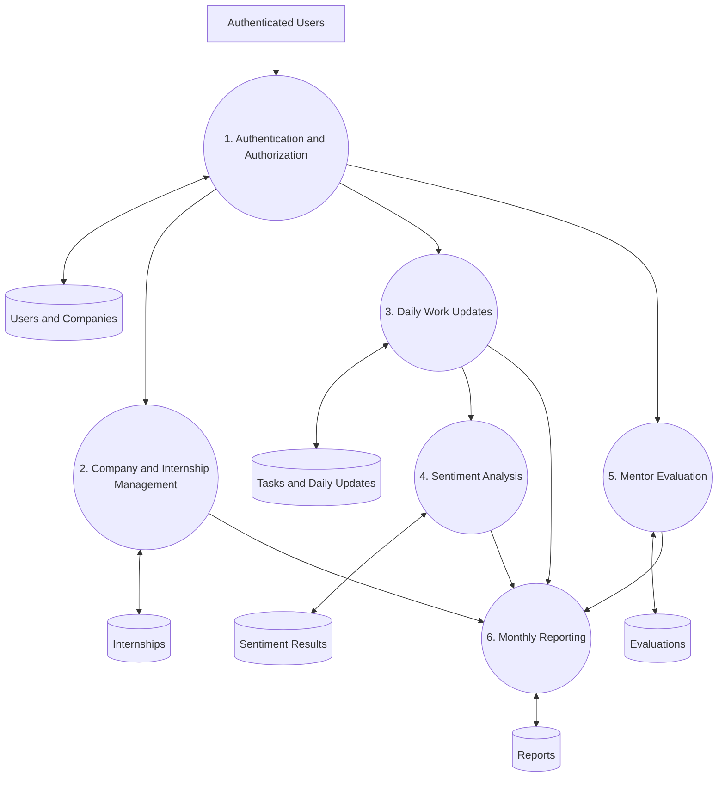

## 4. Entity Relationship Diagram

This is a conceptual diagram of MongoDB document relationships. It does not imply that the database uses a relational SQL schema.

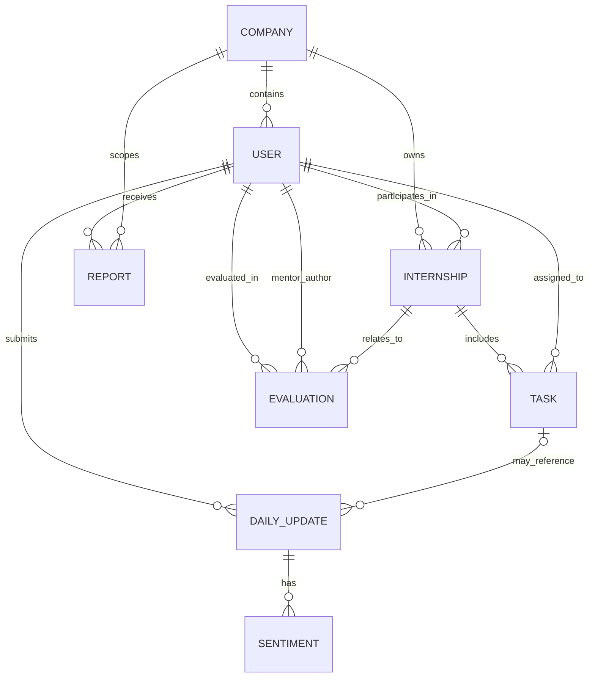

Confirm the relationships against the actual Mongoose schemas before using this as a final database design diagram.

## 5. Login Sequence Diagram

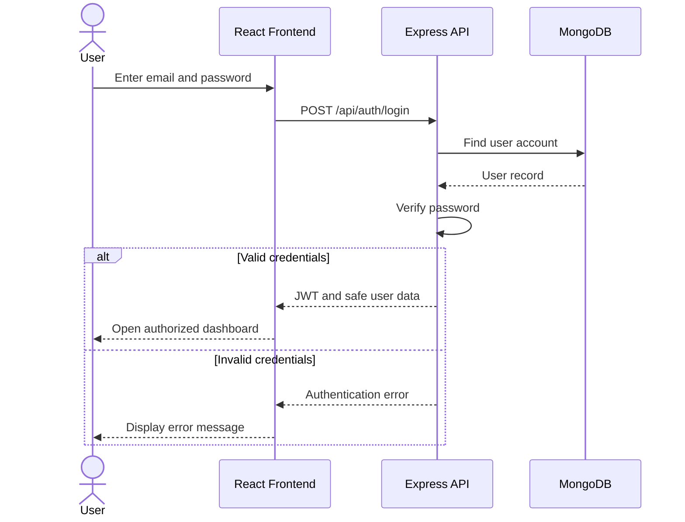

## 6. Daily Update and Sentiment Analysis Sequence

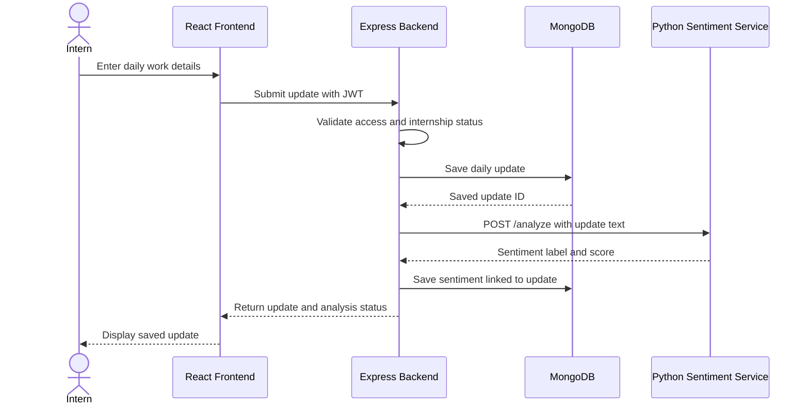

If the sentiment service fails, the application should indicate that analysis is unavailable instead of inventing a sentiment result.

## 7. Mentor Evaluation Sequence

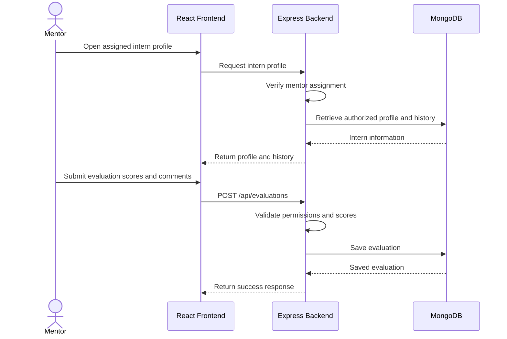

## 8. Activity Diagram

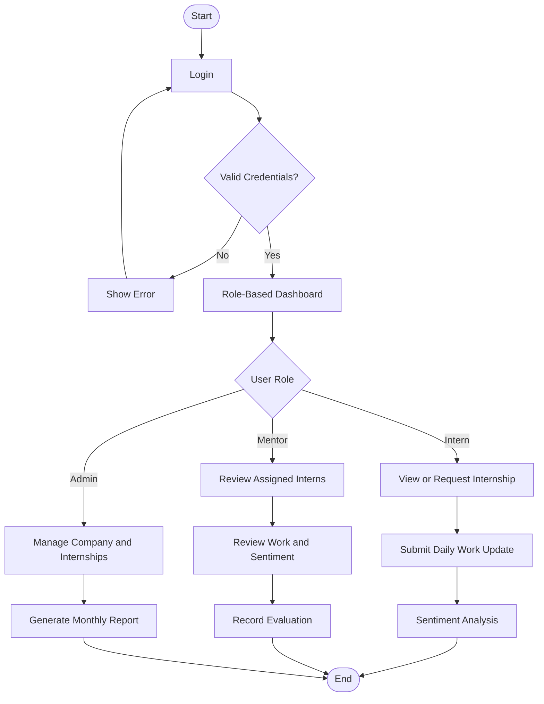

## 9. Deployment Diagram

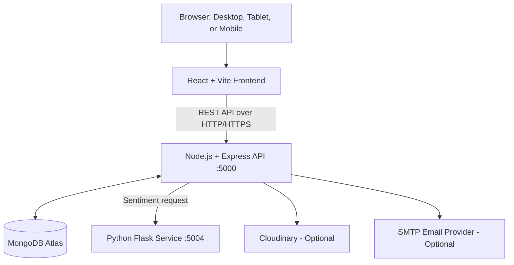

## Authentication and Authorization

- Users authenticate through the login endpoint.
- The backend issues a JWT after successful authentication.
- Protected requests use the `Authorization: Bearer <token>` header.
- Authentication middleware verifies the token and checks the current user state.
- Role-based authorization restricts access to permitted operations.
- Company and mentor-assignment boundaries must be enforced by the backend.
- Sensitive operations should not rely only on frontend route protection.

## Sentiment Analysis

The backend sends daily-update text to a separate Python Flask sentiment-analysis service.

The service returns a sentiment label and score, which the backend can store against the corresponding daily update and intern.

Sentiment results should be displayed as analyzed only when a real result has been successfully obtained and saved.

## Performance Evaluation

Mentors evaluate assigned interns based on the evaluation criteria implemented in the current application. These may include:

- Communication
- Technical skills
- Punctuality
- Task completion
- Teamwork
- Written feedback
- Overall performance score

The permitted score range and final-score calculation should match the actual backend validation and evaluation logic.

## Monthly Reports

Monthly reports can summarize available internship performance information, such as:

- Daily work updates
- Tasks and completion status
- Hours reported
- Sentiment statistics
- Mentor evaluation scores
- Overall progress

Report generation and access should be restricted according to the authenticated user's role and company scope.

## API Endpoints

The following is a route-family reference. Confirm the exact methods, request bodies, and access permissions against the current backend source.

| Method | Endpoint | Purpose |
|---|---|---|
| GET | `/api/health` | Health check, if configured |
| POST | `/api/auth/register` | Register an account |
| POST | `/api/auth/login` | Authenticate a user |
| GET | `/api/auth/me` | Retrieve current user |
| GET / POST / PUT / DELETE | `/api/companies` | Company operations |
| GET | `/api/users` | Retrieve authorized users |
| GET | `/api/users/mentors` | Retrieve available mentors, if configured |
| GET / POST / PUT | `/api/internships` | Internship operations |
| GET | `/api/internships/my-internship` | Retrieve the current intern's internship |
| GET | `/api/internships/available` | Retrieve available internships, if configured |
| POST | `/api/internships/:id/request` | Request an internship, if configured |
| GET | `/api/mentor/dashboard-summary` | Mentor dashboard summary |
| GET | `/api/mentor/interns` | Retrieve assigned interns |
| GET | `/api/mentor/interns/:internId` | Retrieve an assigned intern profile |
| GET / POST / PUT / DELETE | `/api/tasks` | Task operations |
| GET / POST / PUT / DELETE | `/api/daily-updates` | Daily work update operations |
| POST | `/api/sentiment/analyze` | Analyze sentiment, if exposed |
| GET | `/api/sentiment/update/:updateId` | Retrieve sentiment for an update, if configured |
| POST | `/api/sentiment/analyze-missing` | Analyze updates missing results, if configured |
| GET / POST / PUT / DELETE | `/api/evaluations` | Evaluation operations |
| GET | `/api/evaluations/my-evaluations` | Retrieve own evaluations, if configured |
| GET / POST | `/api/reports` | Report operations |
| GET | `/api/reports/mentor` | Retrieve mentor reports, if configured |
| POST | `/api/reports/monthly` | Generate a monthly report, if configured |

## Installation

### Prerequisites

- Git
- Node.js and npm
- Python 3 for the sentiment service
- MongoDB Atlas or a compatible MongoDB deployment

### Clone the Repository

```bash
git clone https://github.com/sarthakdarshane/InternManagement.git
cd InternManagement
```

Use the repository URL and directory name that match your actual GitHub project.

### Install Backend Dependencies

```bash
cd Backend
npm install
```

### Install Frontend Dependencies

```bash
cd ../Frontend
npm install
```

Install the Python service dependencies using the requirements file provided by the project.

## Running the Project

### Start the Backend

```bash
cd Backend
npm run dev
```

The API is expected to use port `5000` when configured with the current default.

### Start the Frontend

Open another terminal:

```bash
cd Frontend
npm run dev
```

Open the local URL printed by Vite. It is commonly `http://localhost:5173`.

### Start the Sentiment Service

Run the Python Flask application using the entry point and dependency instructions in the sentiment service folder. The current configured service port is `5004`.

The exact startup command depends on the files in the repository.

## Environment Variables

Create local environment files from the project's `.env.example` files where available.

Example backend configuration:

```env
PORT=5000
MONGODB_URI=mongodb+srv://<username>:<password>@<cluster>/<database>
JWT_SECRET=<your-long-random-secret>
JWT_EXPIRES_IN=1d
SENTIMENT_SERVICE_URL=http://localhost:5004
```

Optional email and cloud-storage variables may be required if those integrations are enabled.

Example frontend configuration:

```env
VITE_API_URL=http://localhost:5000/api
```

**Important:** The real `.env` files, MongoDB credentials, JWT secrets, email passwords, and API keys must never be committed to GitHub. Use the actual environment variable names from the project's configuration files.

## Testing

Run the test commands defined by the current project.

Example backend test command, if configured:

```bash
cd Backend
node --test
```

Build the frontend, if the corresponding script exists:

```bash
cd Frontend
npm run build
```

Test important workflows before release:

- Login and role-based access.
- Company and internship management.
- Internship requests and approvals.
- Daily work update submission.
- Mentor access to assigned interns only.
- Sentiment analysis success and failure handling.
- Evaluation creation and retrieval.
- Monthly report generation and permissions.
- Responsive frontend behavior.

Document only tests that have actually been executed.

## Security

- Never commit credentials or real environment files.
- Use password hashing rather than storing plaintext passwords.
- Validate authorization on the backend.
- Enforce company and mentor-assignment boundaries.
- Validate incoming request data.
- Avoid exposing sensitive user fields in API responses.
- Do not fabricate sentiment results when the analysis service fails.
- Review `git status` and the staged diff before committing.
- Exclude `node_modules`, build outputs, logs, database dumps, and local secrets from version control.

## Future Enhancements

- PDF and Excel report exports.
- Email notifications and reminders.
- Scheduled monthly reporting.
- Expanded performance analytics.
- Audit logs and monitoring.
- Automated deployment and containerization.
- Additional accessibility and responsive UI testing.

## Project Status

This README describes the intended architecture and workflows. Before publishing a release, verify the project structure, API routes, environment variables, database models, and startup commands against the current source code.

